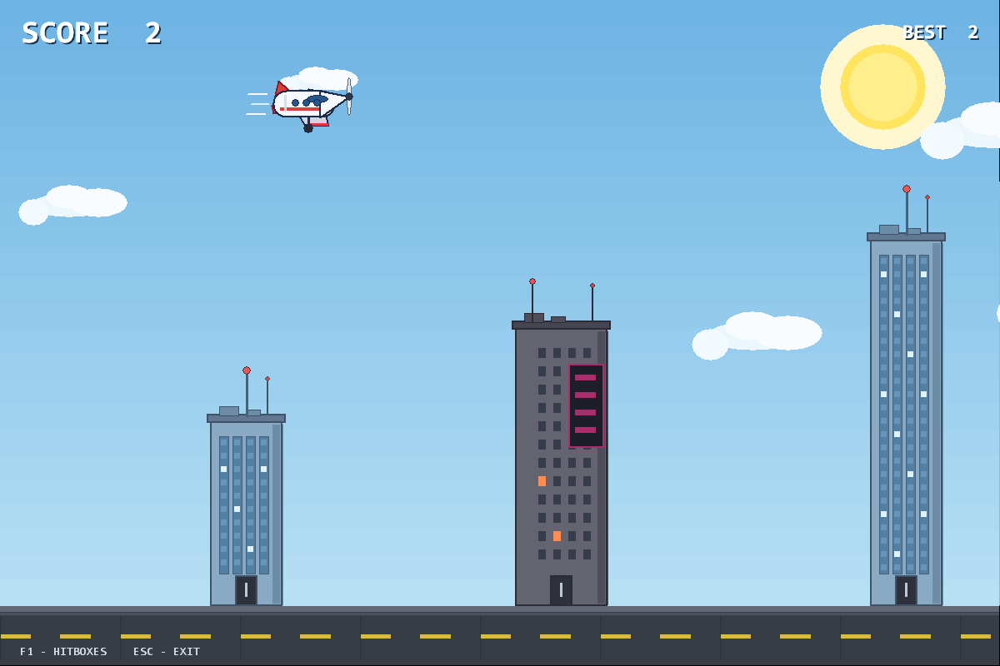

# Flappy Plane — лабораторная работа по ООП

Вариант задания: **самолёт**, который прыгает/летит над серыми небоскрёбами
в стиле Flappy Bird. Конкурирующий объект — **небоскрёбы**.



Проект сделан в стиле `tankexamp`/`busexamp`: консольное WinAPI-приложение,
которое рисует через GDI прямо в консольном окне. Qt не используется —
папка `FlightSim` не тронута.

---

## 1. Как запустить

### Вариант А: Qt Creator

1. Открыть `PlaneSim.pro` **(qmake)** или `CMakeLists.txt` **(CMake)**.
2. Выбрать kit, собрать и запустить.

Если Qt Creator запускает консольное приложение без отдельного окна
(вывод идёт в панель «Application Output»), программа сама вызовет
`AllocConsole()` и создаст консольное окно. Это сделано специально,
потому что рисовать GDI можно только в существующее окно.

### Вариант Б: готовый bat-файл

```bat
build_run.bat
```

Скрипт собирает `PlaneSim.exe` через `g++` из PATH и сразу запускает игру.

### Вариант В: вручную через g++

Из папки `planeexamp`:

```bash
g++ -std=c++11 -O2 -Wall -Wextra planeMain.cpp plane.cpp -lgdi32 -o PlaneSim.exe
PlaneSim.exe
```

Проверено с GCC 14.1.0 (MinGW/MSYS2). Готовый `PlaneSim.exe` уже лежит
в папке.

> Важно: окно лучше не менять после запуска. Backbuffer создаётся один раз
> под текущий размер клиентской области. Если окно развернуть/растянуть,
> картинка останется в старом размере. Это одна из идей для полировки.

---

## 2. Управление

| Клавиша | Действие |
|---|---|
| `SPACE` / `↑` / `W` | «Прыжок» (flap) — самолёт подбрасывает вверх |
| `F1` | Показать/скрыть хитбоксы |
| `ESC` | Выход |
| `SPACE` / `R` после проигрыша | Начать заново |

Правила:

- самолёт постоянно тянет вниз гравитацией;
- нажатие даёт импульс вверх;
- столкновение с небоскрёбом или землёй — крушение и экран `GAME OVER`;
- за каждый пролетевший небоскрёб +1 очко;
- чем больше очков, тем выше скорость прокрутки города (до предела).

---

## 3. Что сделано по пунктам задания

### 1) Класс `Location`

Файлы: `plane.h`, `plane.cpp`.

```cpp
class Location {
protected:
    int X;
    int Y;
public:
    Location(int InitX = 0, int InitY = 0);
    virtual ~Location();

    int GetX() const;
    int GetY() const;
    void SetX(int NewX);
    void SetY(int NewY);
    void SetPosition(int NewX, int NewY);
};
```

Это базовая координата. Она ничего не рисует, но хранит положение и даёт
геттеры/сеттеры. Деструктор виртуальный, чтобы корректно работало
наследование.

### 2) Класс `Point`, наследник `Location`

```cpp
class Point : public Location, public IDisplayable, public IMovable {
protected:
    bool Visible;
public:
    Point(int InitX = 0, int InitY = 0);
    ~Point() override;

    bool IsVisible() const;

    void Show() override;
    void Hide() override;
    void MoveTo(int NewX, int NewY) override;
    void MoveBy(int Dx, int Dy) override;

    virtual void Drag(int Step);
};
```

`Point` уже умеет:

- показываться (`Show` рисует красный маркер-крестик);
- прятаться (`Hide` закрашивает область цветом неба);
- перемещаться (`MoveTo` = `Hide` → новые координаты → `Show`);
- двигаться на смещение (`MoveBy`);
- буксироваться стрелками (`Drag`, как в методичке).

Дополнительно `Point` реализует интерфейсы `IDisplayable` и `IMovable`
из `plane.h`.

### 3) Графический объект варианта — `Plane`, наследник `Point`

```cpp
class Plane : public Point, public ICollidable {
    // ...
    void Show() override;
    void Hide() override;
    void Update();
    void Flap();
    void Crash();
    HitBox GetHitBox() const override;
    bool IsActive() const override;
};
```

Самолёт нарисован примитивами GDI: фюзеляж, нос, крылья, киль,
горизонтальный стабилизатор, кабина, иллюминаторы, шасси, вращающийся винт
и след от прыжка. Рисование вынесено в `DrawFuselage`, `DrawWing`,
`DrawTail`, `DrawPropeller`.

Хитбокс самолёта специально чуть меньше спрайта, чтобы игра прощала
касания краями.

### 4) Механика движения самолёта

В `Plane::Update()`:

- к вертикальной скорости прибавляется гравитация;
- скорость падения ограничена `MaxFallSpeed`;
- положение хранится в `double PreciseY`, чтобы движение было плавным;
- `Flap()` задаёт импульс вверх (`FlapImpulse`);
- выше окна самолёт не улетает (потолок);
- касание земли вызывает `Crash()`.

То есть у самолёта не просто «сдвиг по стрелкам», а полноценная
физика прыжка: чем дольше не нажимать, тем быстрее падение.

### 5) Конкурирующий объект — `SkyScraper`, наследник `Point`

```cpp
class SkyScraper : public Point, public ICollidable {
    void Show() override;
    void Hide() override;
    void Scroll(int Dx);
    void Recycle(int NewX, int NewHeight);
    HitBox GetHitBox() const override;
};
```

Небоскрёб:

- рисуется серым домом с окнами, крышей, антенной и входом;
- едет справа налево через `Scroll`;
- когда уходит за левый край, `Recycle` переносит его вправо
  и задаёт новую случайную высоту;
- имеет хитбокс от крыши до земли.

Чтобы показать наследование и полиморфизм, сделаны два подкласса:

- `GlassTower` — стеклянная башня, переопределяет цвета, окна и шпиль;
- `NeonTower` — тёмная башня с мерцающей неоновой вывеской.

В игре они хранятся в массиве `SkyScraper* Towers[4]`, и вызовы
`Show()`, `GetHitBox()`, `Scroll()` идут через виртуальные функции
базового класса.

### 6) Взаимодействие объектов

- `HitBox` и `Intersects` в `plane.h` — проверка пересечения
  прямоугольников (AABB).
- `Game::CheckCollisions()` перебирает небоскрёбы, проверяет
  `Intersects(PlaneBox, TowerBox)` и при попадании:
  - вызывает `Player.Crash()`;
  - переводит игру в состояние `Crashed`;
  - запоминает точку взрыва.
- `Game::CheckScore()` считает небоскрёб пройденным, когда его правая
  граница оказывается левее самолёта, и начисляет очко.
- После анимации взрыва (`Crashed`) игра переходит в `GameOver`.
- `F1` включает отрисовку хитбоксов — удобно показывать взаимодействие
  на защите.

---

## 4. Иерархия классов

```text
Location
└── Point  (IDisplayable, IMovable)
    ├── Plane  (ICollidable)
    └── SkyScraper  (ICollidable)
        ├── GlassTower
        └── NeonTower
```

Плюс интерфейсы в `plane.h`:

```text
IDisplayable : Show(), Hide()
IMovable     : MoveTo(), MoveBy()
ICollidable  : GetHitBox(), IsActive()
```

`Game` не входит в эту иерархию: это сцена/менеджер, который хранит
объекты, обновляет их и рисует.

---

## 5. Файлы проекта

Исходников ровно три, как в `busexamp`:

| Файл | Что внутри |
|---|---|
| `plane.h` | `HitBox`, `Intersects`, интерфейсы `IDisplayable`/`IMovable`/`ICollidable`, палитра, GDI-хелперы и объявления всех классов |
| `plane.cpp` | GDI-хелперы, все объекты (`Location`, `Point`, `Plane`, `SkyScraper`, `GlassTower`, `NeonTower`) и игровая сцена `Game` |
| `planeMain.cpp` | настройка консоли, `AllocConsole` при необходимости, двойная буферизация, главный цикл |
| `PlaneSim.pro` | проект qmake для Qt Creator (без Qt-модулей, `-lgdi32`) |
| `CMakeLists.txt` | альтернативная сборка через CMake |
| `build_run.bat` | быстрая сборка/запуск через `g++` |
| `preview.png` | скриншот игры |

---

## 6. Технические детали (если спросят на защите)

- Рисование идёт в консольное окно через `GetDC(GetConsoleWindow())`
  и GDI-примитивы (`Rectangle`, `Ellipse`, `Polygon`, `TextOutW`).
- Используется двойная буферизация: кадр рисуется в `CreateCompatibleDC`,
  затем одним `BitBlt` переносится на экран — поэтому нет мерцания.
- Цикл игры — `Sleep(16)`, примерно 60 кадров в секунду.
- Консольный буфер подгоняется под окно, шрифт — `Consolas` 20 px
  (если доступен), курсор скрыт, QuickEdit отключён.
- Если у процесса нет консоли (запуск из IDE с перехватом вывода),
  вызывается `AllocConsole`, а стандартные handles переназначаются
  на `CONOUT$`/`CONIN$`.
- Столкновения — AABB по хитбоксам, без физического движка.
- Полиморфизм: массив `SkyScraper*` хранит разные подклассы, вызовы
  виртуальные; `Plane` и `SkyScraper` реализуют общий `ICollidable`.

---

## 7. Как устроена графика (и как её упростить)

Вся графика — это обычные GDI-примитивы, никаких картинок и Qt. Кадр
рисуется в память (`BackDC`), а потом переносится в консольное окно
одним `BitBlt`. Объекты рисуют через глобальный `hdc`, который указывает
на этот backbuffer.

### 7.1. Хелперы `Gfx`

Чтобы не повторять `CreatePen`/`SelectObject`/`DeleteObject`, сделаны
короткие обёртки в `plane.h` / `plane.cpp`:

```cpp
Gfx::FillRect(hdc, left, top, right, bottom, fill, border, borderWidth);
Gfx::FillEllipse(...);
Gfx::FillRoundRect(...);
Gfx::FillPolygon(hdc, points, count, fill, border, borderWidth);
Gfx::Line(hdc, x1, y1, x2, y2, color, width);
Gfx::Text(hdc, x, y, L"TEXT", size, color, bold);
```

Внутри `FillRect`, например, создаётся перо и кисть, они выбираются
в DC, вызывается `Rectangle`, затем старые объекты возвращаются,
а созданные удаляются. Поэтому в коде объектов нет утечек GDI-объектов.

### 7.2. Слои сцены

`Game::Render` рисует строго по слоям:

1. небо (градиент из 24 полос + солнце);
2. облака;
3. земля;
4. небоскрёбы;
5. самолёт;
6. HUD (счёт/рекорд);
7. хитбоксы (если включены `F1`);
8. взрыв;
9. стартовая/финальная панель.

Порядок важен: например, самолёт рисуется после домов и облаков, поэтому
всегда оказывается сверху.

### 7.3. Небо, облака, земля

- `Game::DrawSky`: 24 горизонтальные полосы, цвет каждой интерполируется
  от `RGB(110,180,228)` к `RGB(182,224,244)`. Полосы — обычные
  `FillRect`. Солнце — три вложенных эллипса.
- `Game::DrawClouds`: у каждого облака 4 белых эллипса со сдвигами;
  структура `Cloud` хранит `X`, `Y`, `Scale`, `Speed`.
- `Game::DrawGround`: тёмный прямоугольник, светлая кромка, пунктир
  из жёлтых прямоугольников и вертикальные швы.

### 7.4. Небоскрёбы

`SkyScraper::Show` рисует дом в таком порядке:

1. тень справа;
2. корпус (`FillRect` с рамкой);
3. затемнённая правая грань;
4. окна (`DrawWindows`);
5. дверь;
6. крыша, вентиляция, антенна (`DrawRoof`);
7. дополнительные детали (`DrawExtra`).

Окна — сетка маленьких прямоугольников. Чтобы они не мигали каждый кадр,
«горит» окно по детерминированному правилу:

```cpp
bool Lit = ((Row * 7 + Col * 13 + WindowSeed) % 17 == 0);
```

Подклассы не копируют весь `Show`, а переопределяют только нужное:

- `GlassTower` — другие цвета, вертикальные стеклянные панели
  (`DrawWindows`) и шпиль (`DrawRoof`);
- `NeonTower` — тёмные цвета, неоновая вывеска (`DrawExtra`)
  и мигающая антенна (`DrawRoof`).

### 7.5. Самолёт

`Plane::Show` — это набор примитивов относительно `X, Y`:

1. след от прыжка (линии, если `FlapFlash > 0`);
2. дальнее и ближнее крылья (`FillPolygon`);
3. киль и стабилизатор (`FillPolygon`);
4. фюзеляж (`FillRoundRect`) и нос (`FillPolygon`);
5. красная полоса, кабина, иллюминаторы, дверь, шасси;
6. винт (`FillEllipse`).

Нос слегка поворачивается от вертикальной скорости:

```cpp
int Tilt = ClampInt((int)(VelocityY * 1.4), -11, 11);
```

Винт «крутится» за счёт изменения высоты эллипса:

```cpp
int PropLen = 5 + (int)(20.0 * fabs(cos(PropPhase)));
```

Хитбокс (`GetHitBox`) — отдельный прямоугольник, меньше спрайта.
Он не зависит от того, насколько красиво нарисован самолёт.

### 7.6. HUD, панели, взрыв

- Текст — `Gfx::Text`/`Gfx::TextShadow` с шрифтом `Consolas`;
  размер задаётся отрицательной высотой в `CreateFontW`.
- Панели — `FillRoundRect` с тёмной заливкой и светлой рамкой.
  Прозрачности нет (GDI без AlphaBlend), поэтому панели непрозрачные.
- Взрыв — 12 лучей + 4 концентрических эллипса; радиус растёт
  от `CrashTimer`.

### 7.7. Как упростить под свой вкус

Самый простой путь — менять только тела `Show`/`DrawX`, не трогая
логику и хитбоксы:

- **Самолёт до прямоугольника:** в `Plane::Show` оставить
  `Gfx::FillRect(hdc, X, Y, X + BodyWidth, Y + BodyHeight, ...)`.
- **Дом до прямоугольника:** в `SkyScraper::Show` оставить корпус,
  дверь и пару окон; убрать тень, крышу, антенну.
- **Небо в один цвет:** в `Game::DrawSky` оставить один `FillRect`
  на весь `GroundY`; убрать солнце.
- **Без облаков:** не вызывать `DrawClouds` (или очистить тело функции).
- **Без панелей:** в `DrawReadyOverlay`/`DrawGameOverOverlay` оставить
  только `Gfx::CenteredText`.
- **Другие цвета:** все константы собраны в начале `plane.h`.
- **Совсем без `Gfx`:** каждую обёртку можно заменить прямыми вызовами
  `CreatePen`/`CreateSolidBrush`/`Rectangle`, как в `tankexamp`.

Если захочется пиксель-арта, можно один раз отрисовать спрайт
в `CreateCompatibleBitmap`, а в `Show` делать `BitBlt` — логика
и хитбоксы при этом не изменятся.

---

## 8. Что можно улучшить позже

- Поддержать изменение размера окна (пересоздавать backbuffer и сцену).
- Добавить паузу, звуки, сохранение рекорда в файл.
- Наклонять самолёт по скорости (сейчас нос лишь слегка поворачивается).
- Сделать несколько типов препятствий с разными хитбоксами.
- Добавить «птиц»/вражеский самолёт как второго конкурента.
